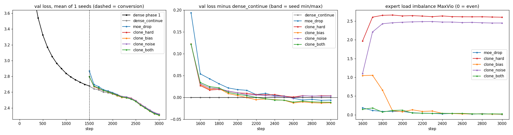
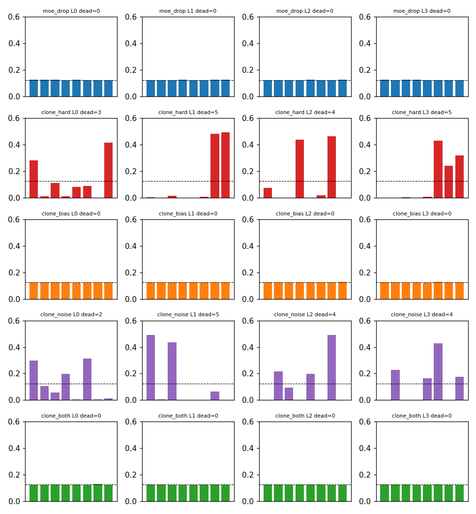

# ERA V5 · Session 14 — Dense ("linear") model → Mixture-of-Experts

Train a dense model, convert it into an MoE, show it **continues to train** and **loss keeps dropping**.
Everything below is generated from `summary.json` (`make_readme.py`) and asserted by `test_readme.py`.
Config `cpu_tiny`, 1 seeds ([0]), device `cpu`, total wall time 156.4 min.



## Setup
| | Dense | MoE after conversion |
|---|---|---|
| Params total / active | 1,246,336 / 1,246,336 | 2,430,080 / 1,250,432 |

Model: decoder, RMSNorm, RoPE, GQA, SwiGLU, tied embeddings (`configs/cpu_tiny.json`). Data: TinyStories with own
byte-level BPE. 4,096 tokens/step; phase 1 dense 1500 steps, then 1500 steps per arm
from the **same checkpoint on identical batches** with one WSD LR schedule over the whole run. fp32 (CPU); router always fp32.

## Conversion (`upcycle.py`)
- **Shared expert** (always on) = crop of the first dense neurons (Rohan's method 1).
- **Routed experts** = drop-upcycling r=0.5: each copies a random half-width subset of the remaining dense neurons,
  redraws the other half (`w1/w3` ~ N(0, dense std), `w2` = 0). Copied `w2` scaled by (remaining/copied) so each expert is
  an unbiased estimate of the remaining dense FFN; gates renormalised to 1 over top-k.
- **Router**: sigmoid, fp32, top-2. **Balancing**: aux-loss-free bias (DeepSeek-V3), selection only, γ=0.01, loads
  accumulated over 8-step windows. **Probabilistic top-k**: annealed Gumbel noise on selection for the first steps.
- AdamW moments carried over for every unchanged tensor (attention, norms, embedding).

## Results (validation loss, single seed)
Phase 1: dense val 7.6447 → 2.6792.

| arm | first eval after conversion | final | steps to regain pre-conversion val (per seed) | final MaxVio | dead experts at end (per seed) | max dead any eval (per seed) |
|---|---|---|---|---|---|---|
| dense_continue | 2.6749 | **2.3184** | [0] | – | – | – |
| moe_drop | 2.8685 | **2.3124** | [199] | 0.013 | [0] / 32 | [0] |
| clone_hard | 2.7974 | **2.3221** | [99] | 2.605 | [17] / 32 | [18] |
| clone_bias | 2.7974 | **2.3062** | [99] | 0.017 | [0] / 32 | [0] |
| clone_noise | 2.7966 | **2.3216** | [99] | 2.450 | [15] / 32 | [16] |
| clone_both | 2.7966 | **2.3073** | [99] | 0.022 | [0] / 32 | [0] |

- **Continues training**: moe_drop goes 2.8685 → 2.3124.
- **MoE vs dense at equal active params**: final difference moe_drop − dense = -0.0060
  (per seed [-0.006]); single seed — direction only, not a claim. Seed-mean MoE stays below dense from step 2599.
- **Ablation — which fix keeps cloned experts alive?** clone_hard (no balancing, no noise) vs clone_bias / clone_noise /
  clone_both isolate the bias balancing and probabilistic selection; moe_drop adds diverse (dropped) initialisation on top.
  Final val per arm: dense_continue 2.3184, moe_drop 2.3124, clone_hard 2.3221, clone_bias 2.3062, clone_noise 2.3216, clone_both 2.3073; dead experts at end:
  moe_drop [0], clone_hard [17], clone_bias [0], clone_noise [15], clone_both [0].

- **Key finding**: arms WITH bias balancing (moe_drop, clone_bias, clone_both) end with
  [[0], [0], [0]] dead experts and finals
  [2.3124, 2.3062, 2.3073] vs dense 2.3184;
  arms WITHOUT it (clone_hard, clone_noise) end with [[17], [15]] dead and finals
  [2.3221, 2.3216]. Probabilistic selection only delays collapse (0 dead while
  noise is on, then experts die). Drop-upcycling's diverse init did not beat plain clones once balancing was on.



### Conversion fidelity (val at step 0, no training)
| variant | val |
|---|---|
| partition_all_experts_on | 2.6792 |
| dense | 2.6792 |
| drop_r_w2zero | 2.9118 |
| drop_r_w2normal | 2.9212 |
| drop_r0_subset_copy | 2.7517 |
| clone | 2.8429 |

`partition_all_experts_on` equals `dense`: the conversion wiring is exact; every other jump comes from routing and redrawing.

## Limitations
- Small model on TinyStories; 1 seeds only. Differences smaller than the seed std are not claims.
- No MoE-from-scratch baseline at equal compute.
- Run on a 1-core CPU sandbox; `session14_moe_upcycling_colab.ipynb` runs the same pipeline at ~20M params × 3 seeds
  (`configs/colab20m.json`) on a Colab L4 — not yet executed.
- Expert compute is a Python loop over experts (no grouped GEMM), so MoE tok/s understates a real kernel.

## Reproduce
```
pip install tokenizers datasets matplotlib pytest
python -m pytest -q test_invariants.py
python run_all.py configs/cpu_tiny.json && python report.py configs/cpu_tiny.json && python make_readme.py
python -m pytest -q
```
